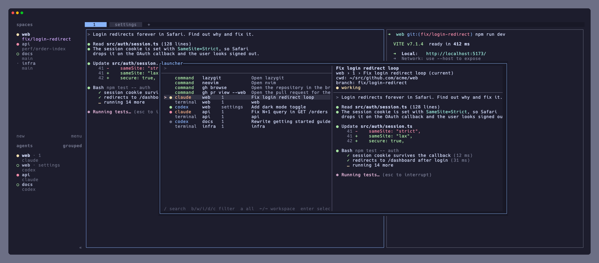
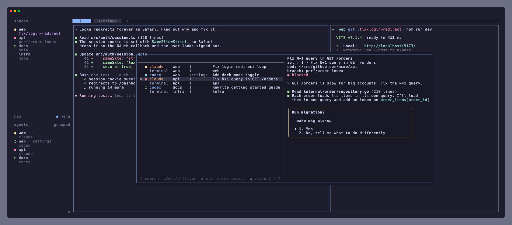

# herdr-launcher

A telescope-like picker for [herdr](https://herdr.dev): run your frequent commands and jump to any pane, with a preview of the pane's screen.



It ships two entry points:

- **launcher** — your commands and every pane in one list, ordered by how often and how recently you picked them (zoxide-style frecency).
- **goto** — a replacement for herdr's built-in goto (`prefix+g`): only panes, in herdr's order, starting on the pane you are in.



## Features

- Every agent and terminal pane on its own row, with aligned workspace / tab / name columns, agent kind (`claude`, `codex`, `terminal`, …) and status dots (working, blocked, idle, done)
- Live preview of the selected pane's screen (refreshed every 0.5 s), its cwd and git branch
- fzf's matching algorithm and extended search syntax
- Vim-like navigation (`j`/`k`, `/` to search, `b`/`w`/`i`/`d` to filter by status), readline/emacs editing in the prompt, and the mouse
- Commands defined in a TOML file: shell commands run in the directory of the pane you opened the launcher from, with their output shown in the preview, or panes such as a lazygit popup, including panes of other plugins
- `catppuccin` (herdr's default) and `ansi` themes, with per-color overrides
- Fast: it talks to herdr's socket directly and shows the first frame in about 30–40 ms

## Requirements

- herdr 0.9.0 or later
- macOS, Linux or Windows
- `curl` or `wget` on macOS and Linux, or PowerShell on Windows, to download the prebuilt binary (or Go 1.27 or later, to build it from source)
- Optional: `lazygit` and `gh` for the default commands

## Install

```sh
herdr plugin install EkeMinusYou/herdr-launcher
```

The install downloads the prebuilt `bin/launcher.exe` (named `.exe` on every platform) for the plugin version from GitHub Releases and checks it against `SHA256SUMS`. To build it from source with Go instead, set `LAUNCHER_FROM_SOURCE=1` for the install.

To update, run the install again. It replaces the installed version and keeps your config. Add `--ref` with a [release](https://github.com/EkeMinusYou/herdr-launcher/releases) tag to pick a version.

```sh
# The latest version
herdr plugin install EkeMinusYou/herdr-launcher
# A specific version
herdr plugin install EkeMinusYou/herdr-launcher --ref v0.4.1
```

To work on the plugin from a local checkout instead, build it once and link it. `plugin link` does not build, but after the first build the launcher rebuilds itself whenever a source file is newer than the binary (except on Windows, where you rebuild it by hand).

```sh
git clone https://github.com/EkeMinusYou/herdr-launcher
cd herdr-launcher
go build -o bin/launcher.exe .
herdr plugin link "$PWD"
```

## Key bindings

Bind the plugin's actions in herdr's `config.toml`:

```toml
[keys]
# Free prefix+g from herdr's built-in goto
goto = ""

[[keys.command]]
key = "prefix+space"
type = "plugin_action"
command = "ekeminusyou.launcher.open"
description = "open launcher"

[[keys.command]]
key = "prefix+g"
type = "plugin_action"
command = "ekeminusyou.launcher.goto"
description = "goto pane"
```

The lazygit popup can also be bound directly. Pass the current pane's directory so it opens there:

```toml
[[keys.command]]
key = "prefix+ctrl+g"
type = "shell"
command = "herdr plugin pane open --plugin ekeminusyou.launcher --entrypoint lazygit --cwd \"${HERDR_ACTIVE_PANE_CWD:-$PWD}\" --focus"
description = "run lazygit"
```

## Usage

By default, both entry points start in select mode.

| Key | Action |
| --- | --- |
| `j` / `k`, `↓` / `↑`, `ctrl-n` / `ctrl-p` | Move the selection |
| `←` / `→` | Jump to the first pane of the previous / next workspace |
| `b` / `w` / `i` / `d` | Show only blocked / working / idle / done agents |
| `c` | Show only commands (when commands and panes are both listed) |
| `a` | Show everything again |
| `/` | Start searching |
| `enter` | Run the command or jump to the pane |
| `q`, `esc` | Close |
| Click, wheel | Select a row (click it again to run it), move the selection |

A shell command runs while the launcher stays open, and its output and exit status appear in the preview. Run it again with `enter`, or close the launcher when you are done; closing stops a command that is still running. A command with `close = true` closes the launcher when it succeeds, and stays open to show the output when it fails. Commands that need the terminal, such as `htop`, can set `interactive = true` to run in the launcher's terminal instead.

While searching, the prompt is edited with readline keys: `ctrl-a` / `ctrl-e`, `ctrl-b` / `ctrl-f`, `alt-b` / `alt-f`, `ctrl-h`, `ctrl-d`, `ctrl-w`, `alt-d`, `ctrl-u`, `ctrl-k`. `esc` leaves the search and keeps the filtered list.

### Search syntax

The search uses fzf's algorithm and its extended syntax. It looks at the row text plus the pane's git branch and path.

| Query | Matches |
| --- | --- |
| `pr gh` | Items containing every term, in any order |
| `lzg` | Fuzzy match |
| `'git` | Exact match |
| `^gh` | Starts with `gh` |
| `web$` | Ends with `web` |
| `hydra !console` | `hydra` but not `console` |

Lowercase terms are case-insensitive; a term with an uppercase letter is case-sensitive.

## Configuration

The launcher reads `config.toml` from the plugin config directory on every open, so edits apply right away. [default_config.toml](default_config.toml) holds the defaults and is also the reference for the format. Anything your `config.toml` leaves out keeps its default: the commands when it has no `commands` (write `commands = []` for none), the theme, and each profile field. Unknown keys are reported as errors, so a typo does not silently do nothing.

```sh
cp default_config.toml "$(herdr plugin config-dir ekeminusyou.launcher)/config.toml"
```

```toml
# "catppuccin" (herdr's default theme) or "ansi" (your terminal's 16 colors)
theme = "catppuccin"

# Optional per-color overrides: #rrggbb or a terminal color number
[colors]
accent = "#89b4fa"

# A shell command, run with `sh -c` (`cmd /c` on Windows) in the directory of the pane you opened
# the launcher from. Its output shows in the preview.
[[commands]]
name = "gh browse"
description = "Open the repository in the browser"
command = "gh browse"
# Close the launcher when it succeeds (on failure it stays open to show the output)
close = true

# A command that needs the terminal runs there instead, and the launcher closes when it exits
[[commands]]
name = "htop"
description = "Show processes"
command = "htop"
interactive = true

# Or one of this plugin's popup panes (lazygit)
[[commands]]
name = "lazygit"
description = "Open lazygit"
pane = "lazygit"

# Or a pane of another plugin
[[commands]]
name = "neovim"
description = "Open nvim"
plugin = "neovim"
pane = "nvim"
```

### Profiles

A profile decides what the picker lists and how it starts. The launcher and goto panes use the profile of the same name, defined in [default_config.toml](default_config.toml):

| Field | Values | launcher | goto |
| --- | --- | --- | --- |
| `start` | `search`, `select` | `select` | `select` |
| `sources` | `commands`, `panes` | `["commands", "panes"]` | `["panes"]` |
| `cursor` | `top`, `current` (the pane you are in) | `top` | `current` |
| `sort` | `herdr`, `name`, `frecency` | `frecency` | `herdr` |

`sort` applies when the query is empty; a search is always ordered by match score.

Change a profile in your `config.toml`. Only the fields you set change; the rest keep their defaults, and profiles you leave out keep working as they are:

```toml
[profiles.goto]
sort = "frecency"
```

You can also add your own profiles. herdr cannot pass arguments to a plugin pane, so pick the profile with an environment variable when you open it:

```toml
# config.toml of the plugin
[profiles.agents]
sources = ["panes"]
start = "search"
```

Fields a new profile leaves out are `start = "select"`, `sources = ["commands", "panes"]`, `cursor = "top"` and `sort = "herdr"`.

```toml
# herdr's config.toml
[[keys.command]]
key = "prefix+a"
type = "shell"
command = "herdr plugin pane open --plugin ekeminusyou.launcher --entrypoint launcher --env LAUNCHER_PROFILE=agents --focus"
description = "search agents"
```

### Frecency

Picking an item records it in the plugin state directory (`history.json`) the way zoxide records directories: each pick adds 1 to its rank, and the score is the rank weighted by recency (×4 within an hour, ×2 within a day, ×0.5 within a week, ×0.25 after that). When the ranks add up to more than 10,000 they are all scaled down, and items that no longer exist are forgotten after 90 days.

Panes are recorded by pane id, so a pane that is closed and opened again starts over.

## Troubleshooting

Errors that happen where they cannot be shown, such as a pane list that fails to load or a pane that fails to open after the launcher has closed, are appended to `launcher.log` in the plugin state directory (`~/.local/state/herdr/plugins/ekeminusyou.launcher/` by default).

## Limitations

- Jumping to a pane uses `pane.focus` from herdr's socket API. It is in herdr's API schema but not yet in its documentation or CLI, so it may change.
- herdr's popup border can break where wide characters (such as Japanese) of the pane behind it touch the border. This comes from herdr's rendering.
- Prebuilt binaries are for macOS, Linux and Windows on arm64 and amd64.
- Windows support follows herdr's plugin documentation but has only been checked by building and testing on Windows in CI, not with herdr on Windows.

## Development

```sh
go test ./...
go build -o bin/launcher.exe .
```

To release, bump `version` in [herdr-plugin.toml](herdr-plugin.toml) and push a matching tag (`v0.1.0`). GitHub Actions runs GoReleaser, which uploads the binaries and `SHA256SUMS`. Release binaries never rebuild themselves.

## License

[MIT](LICENSE)
