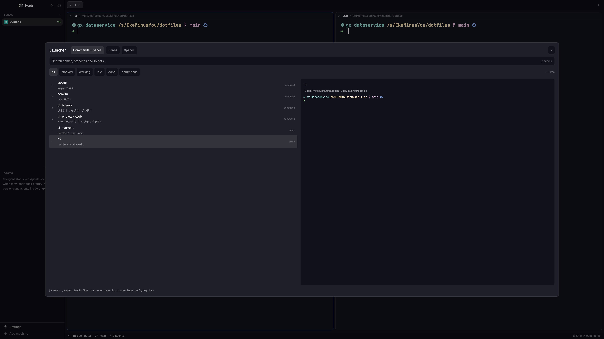

# Launcher

A telescope-like native popup for Herdr UI: run your own commands, find a terminal or mod pane, or switch spaces while reading the selected terminal's screen. Add it to your existing window without replacing its layout. This repository also contains a separate Go plugin for Herdr TUI; this recipe describes the native UI mod only.

## What you see

A centered dialog, 85% of the window's width and 75% of its height, with 16px padding and 12px gaps. It uses the theme's popover background, foreground text, selected rows, muted hints and status colors, in both light and dark themes. The body text is 13px.

From top to bottom: a 16px semibold Launcher heading; buttons for Commands + panes, Panes and Spaces; a close button; a 36px-high native search input; All, Blocked, Working, Idle and Done filter buttons (and Commands in the combined mode), plus the result count. Configuration errors appear below the filters.

The remaining area has two equally sized columns. The left column is a virtualized list of 56px rows: a status marker, a semibold title, an 11px subtitle showing space/tab/program/branch/machine where available, and a status or item kind. The current item is marked “‹ current”. The selected row has the theme's selected background.

The right column is a bordered, rounded preview on the terminal background: selected title, directory, then a scrollable colored screen in 11px JetBrains Mono with 16px rows. Preserve foreground/background colors and basic text styles. A footer explains the current mode's keys or shows that a command is running. No custom images or shipped mods are required. The screenshot includes example commands; the installed configuration is empty.

## How it behaves

Ctrl+Shift+K opens the popup in select mode. The combined mode lists configured commands followed by all panes, sorted by frecency when the query is empty. Panes and Spaces keep Herdr's order and start on the current pane/space. The top buttons, Tab, or Ctrl+1/2/3 switch modes.

`j`/`k`, arrows and Ctrl+N/P move selection and scroll it into view. Left/Right in select mode jump to the first row of the previous/next space. `/` or clicking the input starts native text entry. Search requires every term, fuzzily and with smart case, with `'exact`, `^prefix`, `suffix$` and `!exclude` supported. Search covers the displayed fields and directories. Escape returns to select mode keeping the query; Escape again, `q` in select mode, or × closes. Enter runs/goes to the selection. Clicking a row selects it; clicking it again activates it.

In select mode `b/w/i/d` filter blocked/working/idle/done, `c` filters commands, and `a` restores all. The filter buttons do the same. Working agents use a native 90ms spinner; blocked and done use colored solid dots; idle uses a hollow dot; non-agents have neutral markers. Herdr's live model updates rows and statuses without polling.

A pane pick focuses that exact pane, including a mod pane or a pane in another tab or machine. A space pick shows its existing active tab and preserves focus. Start preview reads immediately on open and selection; refresh every 500ms. On a first visit, show a fast screen-text read before the colored read finishes. Cache up to 32 screens in memory for instant revisits and revalidate them; discard the cache when the popup closes. Prefetch up to two nearby screens after the selected one, with at most one color read and one text read in flight. Prioritize the latest selection when a pending read finishes, without waiting for the next timer tick. Show “Loading terminal…” only if no screen is available after 120ms. Stale results do not replace another terminal's preview.

Configured commands are either an argument vector or a Herdr app action. Argument vectors run in the original pane's directory on its space's machine. Ordinary commands keep the popup open and show stdout, stderr and exit status. `close: true` closes only on success; `interactive: true` closes and starts a terminal tab in that original space. App actions close and run through Herdr. Only one ordinary command can run at a time.

Record picks in per-mod localStorage. Rank increases by one per pick; recency weights are ×4 within an hour, ×2 within a day, ×0.5 within a week, ×0.25 later. Remove entries unused for 90 days and scale ranks to a sum of 9,000 after exceeding 10,000. Queries use match score instead of frecency.

## Built from

One folder, `mods/launcher/`, containing `main.js`, pure helpers in `model.js`, the request coordinator and cache in `preview-loader.js`, the native colored text renderer in `preview.js`, a Python 3 helper in `screen.py`, `config.json` with `{ "commands": [] }`, and `mod.json` with `place: "none"` and the dialog size above. No `layouts/` folder or layout changes. The root `keys.json` is a mergeable snippet, not a replacement for the person's keys.

Use `View` and `div` from gpui-kit; `h_flex`, `v_flex`, `InputState`/`Input`, `v_virtual_list`, `VirtualListScrollHandle` and `Scrollbar` from gpui-base. Set the body row to `items_stretch()` so both columns have a usable height. Create retained input, focus and scrolling state in `init`, never during render or virtual row layout. Handle row clicks on the virtual list by stable item id, not inside its renderer.

Use `spaces()`, `panes()` and a captured `focused()` context for rows and execution targets; `theme()` for colors; `readTextFile`/`appHome()` for the mod's JSON config. Use `run("pane.focus", {pane})`, `run("space.select", {id})`, `run("tab.new", {space, folder, argv, name})` and configured app actions. Close with `closeOverlay(props().overlay)`. Execute vectors with `exec(program, args, {cwd, on})`. Use `nextCommand()` for mod-specific key bindings and native timers for preview data; use `.frames()` for animation.

For colored previews, run `screen.py <terminal>` with Python 3 through `exec`. It starts `hc connect`, requests framed mode, then `terminal.attach` with `observe: true`, `history: 0`, and no caller. It reads the initial screen paint and closes the stream. It sends only control requests, stream credit and close frames: never terminal input, resize or focus frames. Remote terminal addresses include their machine. Bound the process to four seconds, the screen to 40,000 cells, and incoming data to 1 MiB. Decode cursor positioning, erases and SGR styles into rows of styled runs, ignoring titles and terminal mode controls. Render these as native rows and text elements, resolving indexed ANSI colors through `theme()` and higher indexes through the xterm palette. When Python is unavailable or the color read fails, fall back to `hc(["read", terminal, "--lines", "0", "--json"])` and display only the response's `text`, keeping CLI diagnostics out of the preview.

`keys.json` binds Ctrl+Shift+K in global and terminal contexts, and binds selection, Enter, Escape, Tab and Ctrl+1/2/3 in `mod:launcher` so they also work while the input is focused. Local raw key handling supplies the select-mode letters. Configuration is documented with examples in `docs/herdr-mod.md`.

## Watch out

Read the installed `~/.config/herdr-app/AGENTS.md`, `herdr.d.ts` and `gpui-kit.d.ts` first. The app's own files are the API reference; this build was checked on Herdr UI 0.1.9. Never edit shipped mods. Preserve other keys and ask before replacing an existing binding. If `launcher` is taken, rename the new mod, its hardcoded config path and every key binding reference together.

Check operating-system shortcuts as well as Herdr bindings. For example, macOS may reserve Ctrl+Shift+Space before it reaches the app. Prefer a free chord or add the launcher to the person's existing prefix bindings.

This mod reads its config and runs Python 3 and `hc` for colored previews, with a plain-text fallback when Python is unavailable. Configured commands can execute programs and perform whatever network/file operations those programs request; the mod itself makes no HTTP requests. No commands ship by default. It has no dependency on the Go TUI binary, TUI plugin API, TOML config or history.

Colored previews preserve basic text styles and foreground/background colors within 500 columns, 200 rows and 40,000 cells. They do not reproduce terminal images, cursor animation or exact font shaping. Plain-text fallback and command output are limited to their last 40,000 characters. Nonterminal panes have no screen preview. For an inactive space the API may not expose its remembered focused pane; preview the first pane in its active tab when necessary, but selecting the space must not change that focus. Search is not full fzf syntax and has no match highlighting.

The dialog follows window proportions but its controls are sized for a desktop window. Herdr's `exec` has a 30-second limit; closing the popup does not cancel an already started command. Use interactive commands for long tasks. The mod cannot prevent a configured destructive app action: only add actions the person intends. Invalid config must leave pane/space navigation working and show the error.

## Done when

- `herdr-app check mods/launcher` passes with the matching Herdr binary. `node --test tests/herdr-mod.test.mjs`, `python3 -m unittest discover -s tests -p 'test_*.py'` and the existing `go test ./...` pass.
- In a temporary app home, the popup displays both columns and scrolls to keyboard selection, including an initially current item beyond the first screen.
- Search, native text composition, status filters and source changes work; Escape leaves search first. Closing returns normal typing to the terminal.
- Choosing a pane changes the exact focused pane; choosing a space keeps its active tab and pane. A mod pane can be selected without trying to read it as a terminal.
- Terminal preview follows selection, preserves colors and updates while the popup remains open, including readable failures. A first screen appears before color is ready; revisiting a cached screen displays it immediately. A pending read does not defer the latest selection until the next 500ms tick. Observing a screen does not change its dimensions or send input. Changing selection during a read cannot show stale text for another target. Without Python the current screen is still readable without CLI diagnostics.
- Configured commands show successful output and failures; only successful `close: true` commands close. Interactive commands get a new tab in the original space, and remote vectors run on that space's machine.
- Existing TUI installation, config, tests and release artifacts keep working.
