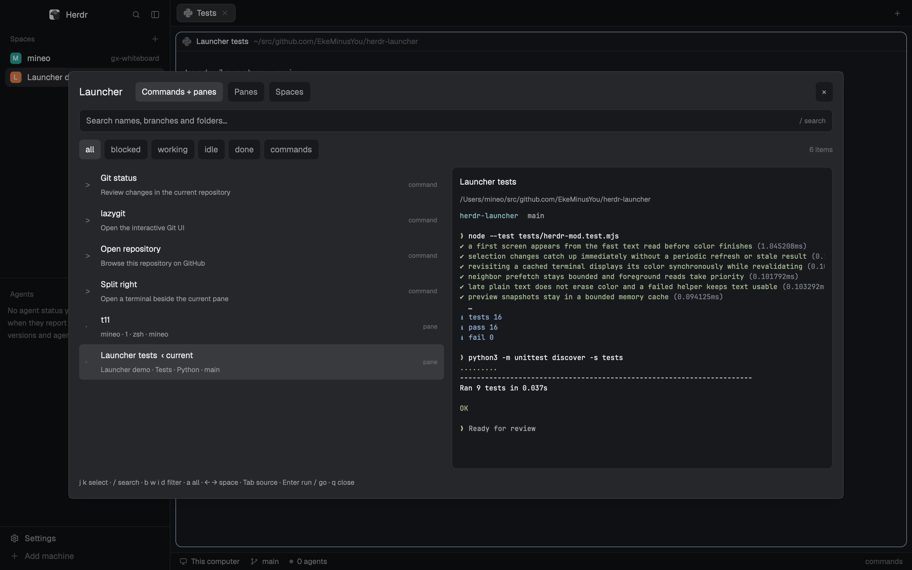
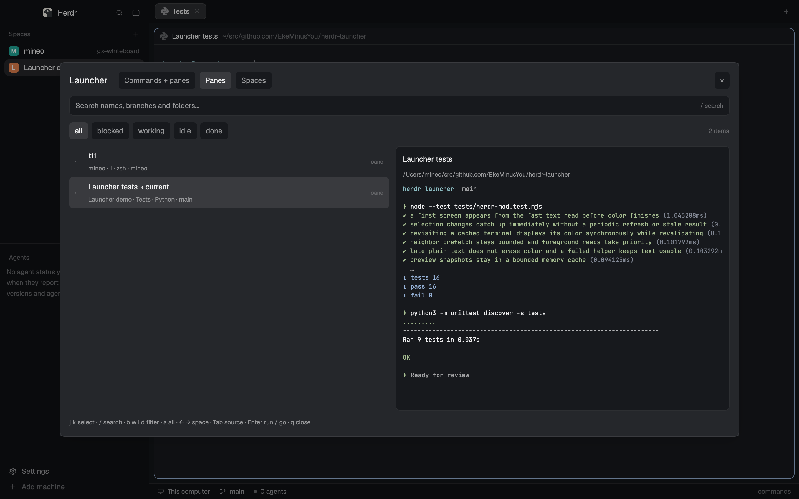

# Launcher for Herdr UI

A native launcher for [Herdr UI](https://herdr.dev): search your commands, panes and spaces in a popup, with a live terminal preview alongside the results.



The screenshots use example commands and a demo terminal. The shipped [config.json](config.json) starts with no commands.

## Features

- **Commands + panes:** your commands and every terminal or mod pane, ranked by how often and how recently you select them.
- **Panes:** jump to a pane in any tab or space, starting on the current pane.
- **Spaces:** switch to a space while preserving its active tab and focused pane.
- Smart-case fuzzy search across names, branches, machines and directories.
- Keyboard navigation, clickable status filters and live agent status indicators.
- Colored terminal previews, refreshed every 500 ms and cached while the popup is open.
- Cell-aligned CJK text and borders; **View terminal / images ↗** opens the actual terminal for graphics, which the core’s preview stream does not replay.
- The current Herdr theme, including light and dark colors.

This mod uses Herdr UI and herdr-core directly. It does not require Go or the [Herdr TUI plugin](../../README.md#herdr-tui-plugin). Configuration and selection history are separate from the TUI plugin.

## Install

Ask your agent:

```text
Read ~/.config/herdr-app/AGENTS.md, then add the Launcher mod from https://github.com/EkeMinusYou/herdr-launcher. Read mods/launcher/README.md and RECIPE.md first, and merge keys.json into my existing keys without replacing bindings.
```

Or install from a local checkout:

1. Copy this `mods/launcher/` directory to `${HERDR_APP_HOME:-$HOME/.config/herdr-app}/mods/launcher/`.
2. Merge the repository's [keys.json](../../keys.json) into your app's `keys.json`, preserving existing bindings. If a shortcut is already taken, choose a free one.
3. Check the installed mod, then open it:

   ```sh
   herdr-app check "${HERDR_APP_HOME:-$HOME/.config/herdr-app}/mods/launcher"
   herdr-app do mod.open '{"name":"launcher"}'
   ```

With the key snippet installed, **Ctrl+Shift+K** opens the popup. No layout changes are needed. Python 3 (`python3` or `python`) enables colored previews; without it, previews use plain text.

If `mods/launcher/` already exists, inspect it before replacing anything. If you choose another directory name, update the `mods/launcher/config.json` path in `main.js` and all `launcher` references in the key snippet together. See the [installation details](../../docs/herdr-mod.md#install) for shortcut troubleshooting.

## Use

The popup starts in select mode. Use the top buttons, Tab, or Ctrl+1/2/3 to switch between Commands + panes, Panes and Spaces.

| Key | Action |
| --- | --- |
| `j` / `k`, Down / Up, Ctrl+N / Ctrl+P | Move the selection |
| Left / Right in select mode | Jump to the previous / next space's first row |
| `/` or click the search field | Start searching |
| `b` / `w` / `i` / `d` in select mode | Filter blocked / working / idle / done |
| `c` / `a` in select mode | Show commands only / all items |
| Tab | Cycle the three sources |
| Ctrl+1 / Ctrl+2 / Ctrl+3 | Commands + panes / panes / spaces |
| Enter | Run the command or go to the selected pane or space |
| Escape | Leave search, keeping the query; in select mode, close |
| `q` in select mode or × | Close |
| Click a row | Select it; click the selected row again to activate it |

Space-separated search terms must all match. Use `'exact`, `^prefix`, `suffix$` and `!exclude`; a term containing uppercase letters is case-sensitive. The mod's matcher is separate from the TUI's fzf matcher.



## Add commands

Edit the installed `mods/launcher/config.json`, then reopen the popup:

```json
{
  "commands": [
    {
      "name": "Git status",
      "description": "Review changes in the current repository",
      "argv": ["git", "status", "--short"]
    },
    {
      "name": "lazygit",
      "description": "Open the interactive Git UI",
      "argv": ["lazygit"],
      "interactive": true
    },
    {
      "name": "Open repository",
      "argv": ["gh", "browse"],
      "close": true
    },
    {
      "name": "Split right",
      "action": "pane.split",
      "args": { "direction": "right" }
    }
  ]
}
```

Each command needs a unique `name` and exactly one of `argv` or `action`:

- **`argv`:** runs on the original pane's machine, in its directory. Output and exit status appear in the preview. Arguments are passed literally; for shell syntax, explicitly invoke a shell such as `["sh", "-lc", "git status && git diff --stat"]`.
- **`interactive: true`:** opens a terminal tab in the original space for programs such as lazygit or long-running tasks.
- **`close: true`:** closes the popup after a successful noninteractive command; errors remain visible.
- **`action` and optional `args`:** closes the popup and runs a Herdr app command. Use `herdr-app commands` to list supported commands.

Ordinary commands have Herdr's 30-second execution limit. Closing the popup does not cancel an already started command. Invalid configuration displays an error while pane and space navigation remain available.

## More

- [Detailed behavior, preview limits and development checks](../../docs/herdr-mod.md)
- [Installation and implementation recipe](../../RECIPE.md)
- [Key-binding snippet](../../keys.json)
- [Herdr TUI plugin](../../README.md#herdr-tui-plugin)
